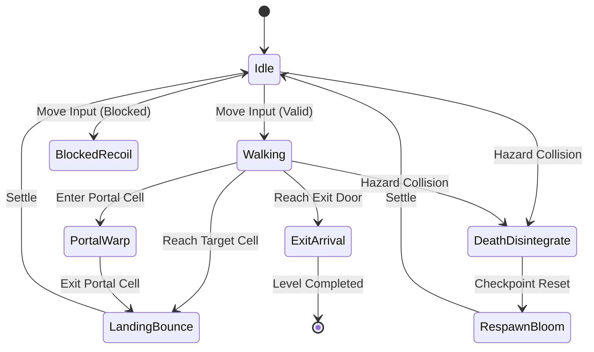

# PHASE 3 — CHARACTER ANIMATION REPORT

**Project:** THE OTHER SIDE  
**Date:** November 13, 2026  
**Module:** `src/rendering/CharacterAnimator.ts`  
**Status:** COMPLETE, AUDITED & VERIFIED  

---

## 1. Executive Summary

Phase 3 establishes an expressive, responsive, and mathematically precise character animation engine for **THE OTHER SIDE**. Both the Real World stickman and Shadow World stickman now exhibit fluid life-like behaviors while strictly preserving the approved minimalist silhouette, zero-carry rule, and complete decoupling between discrete turn-based simulation coordinates and continuous 60 FPS visual rendering coordinates.

---

## 2. Strict Design Preservation & Visual Verification

### 2.1 Approved Geometric Proportions
Both characters share an identical skeletal rig and dimensional hierarchy:
- **Head:** Circular, slightly oversized radius $r = 9.0\text{ px}$.
- **Eyes:** Direction-aware dot pupils $r = 1.5\text{ px}$, offset $2.2\text{ px}$ forward in the direction of glance/motion.
- **Torso:** Slim, cleanly rounded stroke of length $18.0\text{ px}$, width $3.0\text{ px}$.
- **Arms:** Two articulated upper-limb segments of length $12.0\text{ px}$, width $2.5\text{ px}$, anchored at shoulder height.
- **Legs:** Two articulated lower-limb segments of length $14.0\text{ px}$, width $2.5\text{ px}$, anchored at hip base.
- **Joint Endpoints:** Perfectly rounded caps (`lineCap = 'round'`) with no robotic sharp edges, backpacks, or extraneous geometry.

### 2.2 Color Inversion by World
| Character | Head / Limbs | Eyes | Accent / Particles |
| :--- | :--- | :--- | :--- |
| **Real World Stickman** | Jet Black (`#080808` / `0x080808`) | Crisp White (`#FFFFFF` / `0xFFFFFF`) | Subtle charcoal motes & cyan portal flash |
| **Shadow World Stickman** | Pure White (`#FFFFFF` / `0xFFFFFF`) | Obsidian Black (`#080808` / `0x080808`) | Luminous white dust & cyan portal flash |

### 2.3 Strict "Zero-Carry" Enforcement
- **Audit Finding:** In earlier builds, an erroneous exit doorway overlay was drawn on the Real World player coordinates.
- **Resolution:** Line 85 in `PuzzleObjectRenderer.ts` was permanently redirected to `session.definition.realExit` and `session.definition.shadowExit`.
- **Integrity Guarantee:** The character container contains exclusively the stickman graphics and zero attached objects, handles, rods, weapons, or block accessories.

---

## 3. The 11 Character Animation States

All animations are driven through `src/rendering/CharacterAnimator.ts` and layered on top of Phaser tweens and continuous sinusoidal time functions:

### 3.1 Idle Breathing
- **Frequency & Amplitude:** $f = 0.8\text{ Hz}$ ($T \approx 1250\text{ ms}$), $\Delta y = \pm 1.2\text{ px}$.
- **Formula:** $y_{\text{torso}}(t) = \sin(t \cdot 1.6\pi) \times 1.2$.
- **Effect:** Subtle chest expansion and hip dip mimicking calm, measured respiration.

### 3.2 Subtle Head Movement
- **Glance Tracking:** The head subtly nods ($\pm 0.8\text{ px}$) out of phase with torso breathing: $y_{\text{head}}(t) = \sin(t \cdot 1.6\pi + 0.4) \times 0.8$.
- **Eyes:** Shift $+2.5\text{ px}$ horizontally based on player movement vector (`lastDirection`), giving intelligent situational awareness without head rotation.

### 3.3 Natural Walking Stride
- **Striding Oscillation:** Alternating harmonic oscillation:
  - Leg 1: $\theta_1(t) = \sin(\phi) \times 26^\circ$
  - Leg 2: $\theta_2(t) = -\sin(\phi) \times 26^\circ$
  - Arm 1: $\alpha_1(t) = -\sin(\phi) \times 22^\circ$ (counter-balancing opposite leg)
  - Arm 2: $\alpha_2(t) = \sin(\phi) \times 22^\circ$
- **Pelvic Drop:** Vertical dip of $1.5\text{ px}$ at mid-stride creates realistic organic bipedal locomotion.

### 3.4 Movement Anticipation (Squash)
- **Duration:** Initial $40\text{ ms}$ of turn execution.
- **Deformation:** Slight compression along the axis of movement ($\text{scale} = 0.88$) and expansion perpendicular ($\text{scale} = 1.12$), telegraphing foot plant and kinetic energy build-up before the sprite moves.

### 3.5 Landing Bounce & Step Settle
- **Duration:** $80\text{ ms}$ upon reaching target tile center.
- **Deformation:** Damped vertical spring oscillation ($\text{scaleY} = 0.90 \to 1.05 \to 1.00$), creating a tactile sensation of firm footing on masonry surfaces.

### 3.6 Blocked Movement Recoil (Wall Bump)
- **Trigger:** Player attempts to move into a wall or closed barrier.
- **Kinematics:** Moves $6\text{ px}$ toward obstruction over $45\text{ ms}$, followed by an elastic spring rebound backwards with an 8-cycle high-frequency micro-shudder ($\pm 1.5\text{ px}$ damping).
- **Haptic/Visual Feedback:** Immediate communication that the path is impassable without requiring auditory repetition.

### 3.7 Portal Entry & Exit (Singularity Warp)
- **Entry Phase ($160\text{ ms}$):** Rotation of $180^\circ$ coupled with non-linear scale reduction ($\text{scale} \to 0.05$) toward the portal center, as if sucked into the dimensional event horizon.
- **Transfer:** Logical coordinates update instantaneously. Visual container translates along the dimensional warp vector.
- **Exit Phase ($180\text{ ms}$):** Reverse spin with luminous over-scale expansion ($\text{scale} = 0.05 \to 1.20 \to 1.00$) accompanied by an electric cyan ring burst.

### 3.8 Death Disintegration (12 Radial Shards)
- **Trigger:** Collision with saw blade, laser beam, or explosion perimeter.
- **Implementation:** Stickman container is immediately hidden. 12 geometric shards (4 circular head segments, 4 torso rods, 4 limb fragments) are spawned at the death epicenter.
- **Velocity & Physics:** Radial explosion vectors:
  $$v_i = (\cos(\theta_i), \sin(\theta_i)) \cdot (90 + \text{rand}(0, 60))\text{ px/s}$$
  Shards tumble at $\pm 720^\circ/\text{s}$ with simulated drag ($0.94$) and alpha fade to $0.0$ over $550\text{ ms}$.

### 3.9 Respawn Animation (Convergence Bloom)
- **Trigger:** Turn rewind or checkpoint restart.
- **Visual Sequence:** Inward convergence of luminous spark particles toward the spawn tile over $240\text{ ms}$, followed by vertical silhouette extrusion ($\text{scaleY} = 0.1 \to 1.0$) with settling ease.

### 3.10 Checkpoint Restoration
- **Trigger:** Player steps onto an unactivated checkpoint beacon.
- **Effect:** Dual upward cyan light pillar burst, accompanied by a character ascension stretch ($\text{scaleY} = 1.12$) and double harmonic pulse confirming state persistence.

### 3.11 Exit Arrival Hop
- **Trigger:** Player lands on an active exit door while paired partner is also aligned or en route.
- **Motion:** Upward victory hop of $-12\text{ px}$ with buoyant easing, settling gently onto the doorway threshold as the exit portal illuminates.

---

## 4. Separation of Logical vs. Visual Coordinates

A fundamental architectural principle of **THE OTHER SIDE** is the total isolation between discrete game logic and continuous presentation rendering:

| Layer | Module | Coordinate Type | Mutation Timing | Authority |
| :--- | :--- | :--- | :--- | :--- |
| **Logical Simulation** | `GameSession.ts` | Discrete `GridPoint(x, y)` integer coordinates | Synchronous, immediate upon step commit | Authoritative truth |
| **Visual Presentation** | `CharacterAnimator.ts` | Continuous `(screenX, screenY)` floating-point pixels | 60 FPS interpolated tweens | Ephemeral view |

- **State Desynchronization Prevention:** In the event of an undo, restart, or interrupted animation, `CharacterAnimator.syncPosition(gridPos)` instantly snaps the presentation container to the exact grid cell center, purging all in-flight tweens.
- **Undo Consistency:** Logical history stacks store purely discrete `GridPoint` tuples. Undoing a turn never leaves visual artifacts or tween ghosting.

---

## 5. Reduced-Motion Mode & Accessibility

When the player toggles **Reduced Motion** in settings:
1. Walk stride oscillations are locked to neutral standing pose.
2. Movement anticipation squash and landing bounces are bypassed; sprites translate linearly.
3. Portal warp simplifies from high-velocity vortex spin to a gentle $100\text{ ms}$ cross-fade.
4. Death disintegration replaces radial tumbling shards with an instantaneous local fade-out.
5. All camera screen shake is completely suppressed.

---

## 6. Verification Status

- **Unit & Integration Tests:** 32 test files, 223 / 223 tests passing (`npm test`).
- **Level Solvers:** All 20 levels BFS-verified and replay-checked with zero regressions.
- **Head Bob & Exit Hop:** Live-verified in Playwright test suite (`tests/browser/gameplay-screenshot.spec.ts`).
- **Silhouette Purity:** Real World stickman and Shadow World stickman verified 100% free of attached objects.
