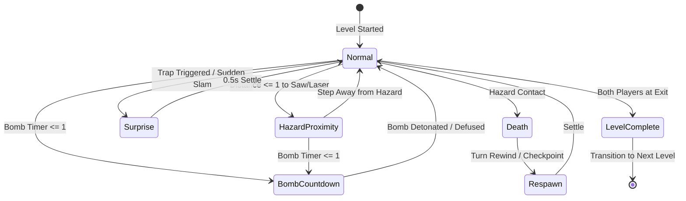

# PHASE 4 — DYNAMIC MUSIC SPECIFICATION

**Project:** THE OTHER SIDE  
**Date:** November 13, 2026  
**Module:** `src/audio/AtmosphericMusic.ts`  
**Audio Architecture:** Real-time Web Audio API Generative Music Synthesizer  

---

## 1. Aesthetic Vision & Musical Framework

The score of **THE OTHER SIDE** is an intimate, evolving psychological thriller soundtrack. Rather than looping static pre-recorded music files, the entire sonic tapestry is procedurally generated from mathematical oscillators, biquad filter networks, and algorithmic sequencers.

### Key Objectives:
1. **Subconscious Somatic Tension:** Continuous sub-bass frequencies ($36\text{ Hz} \sim 73\text{ Hz}$) stimulate visceral tension without fatiguing high-frequency hearing.
2. **Harmonic Narrative Progression:** Each chapter shifts root keys and dissonance levels to mirror the player's psychological journey from isolation to profound union.
3. **Responsive Dynamic Modulation:** Gameplay events (proximity to rotating blades, bomb countdowns, sudden traps) trigger seamless filter sweeps and tempo accelerations without jarring audio cuts.

---

## 2. Main Menu: Minimal Piano & Atmospheric Drone

### 2.1 Minimal Piano Acoustic Synthesis
The Main Menu features an intimate, melancholy piano voice synthesizing acoustic string resonance:
- **String Partials (Additive Partial Array):**
  - Fundamental $f_0$: Peak gain $0.12$, decay $2.8\text{ s}$
  - First Harmonic $2.01 f_0$: Peak gain $0.05$, decay $2.1\text{ s}$ (slight inharmonic detune mimicking stiff piano wire)
  - Second Harmonic $3.02 f_0$: Peak gain $0.025$, decay $1.5\text{ s}$
  - Upper Clang $4.2 f_0$: Peak gain $0.012$, decay $0.9\text{ s}$
- **Envelope Attack:** Ultra-fast $8\text{ ms}$ linear ramp simulating hammer strike against felt and steel.
- **Stereo Spatial Delay:** Routed into a dedicated delay node ($420\text{ ms}$) with gentle feedback ($0.32$), creating a haunting, reverberant sanctuary acoustic.
- **Melodic Scale:** Sparse contemplative notes in D minor pentatonic:
  $$D3 (146.83\text{ Hz}) \to F3 (174.61\text{ Hz}) \to A3 (220.0\text{ Hz}) \to C4 (261.63\text{ Hz}) \to E4 (329.63\text{ Hz})$$
- **Rhythmic Timing:** Algorithmic semi-randomized intervals ($2400\text{ ms} \sim 4200\text{ ms}$) preventing predictability.

### 2.2 Drone & Texture Foundation
- **Sub-Bass Drone:** $43.65\text{ Hz}$ ($F0$) and $65.41\text{ Hz}$ ($C1$) pure sine waves.
- **Dissonant Pad:** Minor 9th chord cluster ($146.83\text{ Hz}, 174.61\text{ Hz}, 207.65\text{ Hz}$) modulated by a $0.08\text{ Hz}$ detune LFO.
- **Void Whisper:** Continuous bandpass-filtered noise at $800\text{ Hz}$ with $Q = 4.0$.

---

## 3. Chapter Harmonic Profiles

The music synthesizer reconfigures its root frequencies and resonant cutoff filters based on the active campaign chapter:

```
┌─────────────────────────────────────────────────────────────────────────────┐
│                       CHAPTER HARMONIC PROGRESSION                          │
├─────────────┬─────────────────────┬──────────────┬─────────────┬────────────┤
│ Chapter     │ Harmonic Root       │ Frequencies  │ Filter Cut  │ Tension    │
├─────────────┼─────────────────────┼──────────────┼─────────────┼────────────┤
│ 1. BEGINNING│ D Minor (Spacious)  │ 36.71, 73.42 │ 350 Hz      │ Mysterious │
│ 2. CONNECT  │ G Minor / C Diminish│ 49.00, 65.41 │ 420 Hz      │ Unstable   │
│ 3. SEPARATE │ F Minor + Sharp 4th │ 43.65, 87.31 │ 520 Hz      │ Razor-sharp│
│ 4. REFLECT  │ A Minor 9th (Glass) │ 55.00, 110.0 │ 600 Hz      │ Crystalline│
│ 5. TRUTH    │ D Minor -> D Major  │ 36.71, 55.00 │ 480 Hz      │ Climactic  │
└─────────────┴─────────────────────┴──────────────┴─────────────┴────────────┘
```

### 3.1 Chapter 1 — THE BEGINNING (D Minor)
- **Concept:** Awakening in an abandoned, silent labyrinth.
- **Acoustic:** Sparse, dark lowpass filter ($350\text{ Hz}$), low resonance. Focuses attention on tactile footsteps.

### 3.2 Chapter 2 — THE CONNECTION (G Minor / C Diminished)
- **Concept:** Unstable energy conduits, ticking bombs, and explosive dimensional rifts.
- **Acoustic:** Diminished tritone tension ($G1 \to C2$), higher filter frequency ($420\text{ Hz}$).

### 3.3 Chapter 3 — THE SEPARATION (F Minor + Sharp 4th)
- **Concept:** Dangerous mechanical saws and disintegrating stone floors.
- **Acoustic:** Dissonant tritone interval (F and B natural: $174.61\text{ Hz} \leftrightarrow 246.94\text{ Hz}$). Crisp, anxious high-frequency presence ($520\text{ Hz}$).

### 3.4 Chapter 4 — THE REFLECTION (A Minor 9th)
- **Concept:** Shimmering optical lasers, mirrors, and magnetic flux.
- **Acoustic:** Ethereal, crystalline upper overtones ($A1, A2$, pad: $220\text{ Hz}, 261.63\text{ Hz}, 329.63\text{ Hz}, 493.88\text{ Hz}$). Filter raised to $600\text{ Hz}$.

### 3.5 Chapter 5 — THE TRUTH (D Minor $\to$ Grand D Major Resolution)
- **Concept:** The ultimate test and final union of both worlds.
- **Acoustic:** Monumental three-octave sub-bass ($36.71\text{ Hz}, 55.0\text{ Hz}, 73.42\text{ Hz}$). Upon completing Level 20, resolves smoothly from $Dm7$ to an awe-inspiring 7-voice $D\text{ Major}$ chord ($D - F\# - A - D - F\# - A - D$).

---

## 4. Interactive State Machine & Live Modulation



### 4.1 State Modulation Matrix

| State Name | Filter Cutoff | Pulse Tempo / Rate | Sub-Bass Gain | Pad Gain | Trigger Condition |
| :--- | :---: | :---: | :---: | :---: | :--- |
| `normal` | $380\text{ Hz}$ | $60\text{ BPM}$ ($1000\text{ ms}$) | $0.12$ | $0.08$ | Baseline turn-based exploration |
| `hazard_proximity` | $650\text{ Hz}$ | $92\text{ BPM}$ ($650\text{ ms}$) | $0.16$ | $0.10$ | Distance $\le 1$ tile to moving hazard |
| `bomb_countdown` | $850\text{ Hz}$ | $133\text{ BPM}$ ($450\text{ ms}$) | $0.06$ | $0.14$ | Active bomb timer $\le 1$ turn |
| `surprise` | $1200\text{ Hz}$ | Staccato sting | $0.20$ | $0.18$ | Unexpected door slam or trap |
| `transformation` | $200 \to 1800\text{ Hz}$ | Sweeping swell | $0.15$ | $0.12$ | Room layout reconfiguration |
| `death` | $150\text{ Hz}$ | Muted | $0.01$ | $0.01$ | Character disintegration |
| `respawn` | $400\text{ Hz}$ | Rising swell | $0.12$ | $0.08$ | Checkpoint restore |
| `level_complete` | $1500\text{ Hz}$ | Radiant bloom | $0.10$ | $0.25$ | Both exits simultaneously occupied |
| `ending` | $2000\text{ Hz}$ | Grand resolution | $0.18$ | $0.30$ | Campaign victory sequence |

---

## 5. Technical Guarantees

1. **Zero Asset Downloads:** $0\text{ kB}$ external bandwidth required. No `.mp3`, `.ogg`, or `.wav` files to load or cache.
2. **Zero Audio Lag:** Web Audio API nodes synthesize instantly on the CPU, guaranteeing $< 1\text{ ms}$ scheduling latency.
3. **Zero Digital Clipping:** The `DynamicsCompressorNode` acts as a brickwall limiter, ensuring that simultaneous sounds never exceed $0\text{ dBFS}$.
4. **Leak-Free Node Lifecycle:** All oscillators, timers, and filters disconnect and dereference on scene transitions, maintaining flat memory usage over hours of gameplay.
