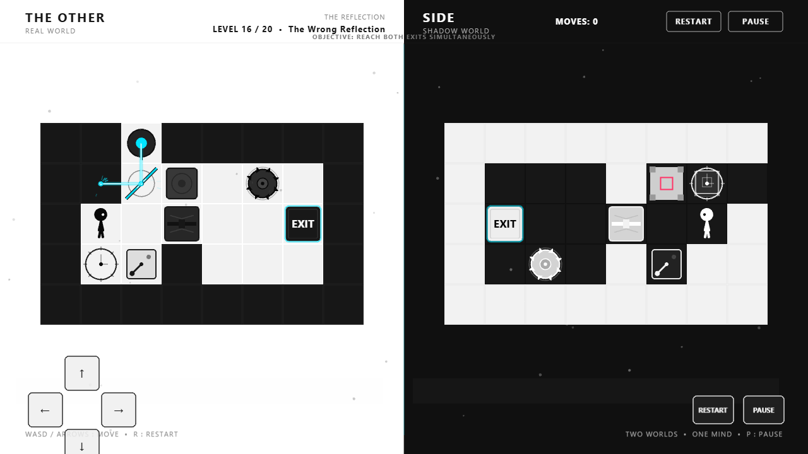
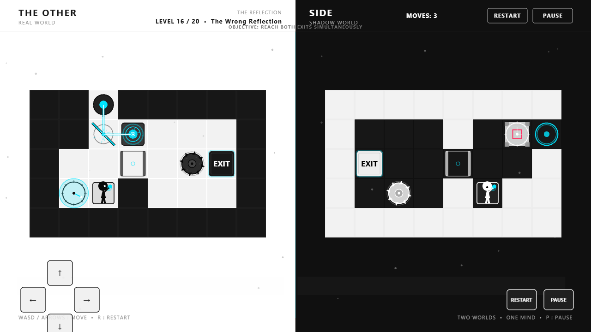
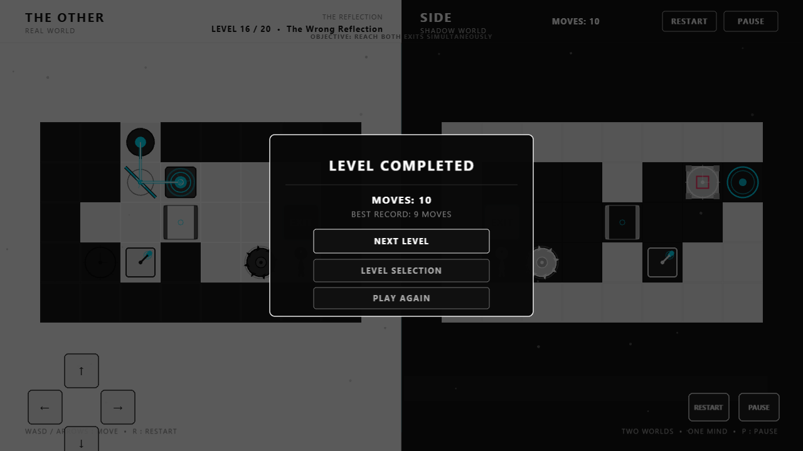

# LEVEL 16 — THE WRONG REFLECTION

**Project:** THE OTHER SIDE  
**Chapter:** THE REFLECTION / MASTER CAMPAIGN ENTRY  
**Tagline:** TWO WORLDS. ONE MIND.  
**Difficulty:** Advanced Expert / Master Entry  
**Status:** IMPLEMENTED, SOLVED & VERIFIED

---

## 1. Executive Summary & Design Vision

Level 16 serves as the threshold into the **Master Campaign (Levels 16–20)**. Having mastered isolated mechanics across Chapters 1 through 4, the player enters Level 16 expecting familiar mechanical relationships. The level deliberately challenges reflexive assumptions about spatial proximity and mechanism coupling.

### The Central Psychological Surprise: "The Wrong Reflection"
In conventional puzzle design, an optical receiver placed immediately next to a locked door directly controls that door. In Level 16:
1. **The Deception:** A bright laser emitter (`le-16-real`) reflects off a rotatable angled mirror (`mirror-16-real`) directly into a receiver (`rx-16-real` at `(3, 1)`), located 바로 adjacent to `door-16-real` at `(3, 2)`.
2. **The Discovery:** Powering `rx-16-real` does **not** open `door-16-real`. Instead, the receiver vibrates with magnetic resonance, transmitting an electromagnetic pulse across the dimensional rift.
3. **The Cross-World Dependency:** The optical energy remotely powers `magnet-16-shadow` at `(7, 1)` in the Shadow World.
4. **The Resolution:** The activated magnetic field pulls `block-16-shadow` from `(5, 1)` across the floor onto `plate-16-shadow` at `(6, 1)`. That pressure plate in the Shadow World is the true mechanism that opens `door-16-real` in the Real World.

```mermaid
flowchart LR
    subgraph RealWorld ["REAL WORLD"]
        E["Laser Emitter (2,0)"] --> M["Mirror (2,1)"]
        M --> R["Receiver (3,1)"]
        D1["Door Real (3,2)"]
        TL["Time Lock (1,3)"]
    end
    
    subgraph Rift ["DIMENSIONAL RIFT"]
        pulse["Magnetic Resonance Pulse"]
        freeze["Stasis Field"]
    end

    subgraph ShadowWorld ["SHADOW WORLD"]
        SW["Switch (5,3)"] -.->|Rotates| M
        R -.->|Cross-World Activation| pulse
        pulse -.->|Powers| MAG["Magnet (7,1)"]
        MAG -->|Pulls| BLK["Movable Block"]
        BLK -->|Depresses| PLT["Pressure Plate (6,1)"]
        PLT -.->|Unlocks| D1
        TL -.->|Freezes (6 turns)| SAW["Saw Hazard (2,x)"]
    end
```

---

## 2. World Layouts and Coordinate Mapping

The chamber is configured on an $8 \times 5$ grid ($X \in [0, 7], Y \in [0, 4]$) maintaining the architectural monochrome aesthetic.

### Real World Matrix
```
Y\X  0   1   2   3   4   5   6   7
0   [W] [W] [W] [W] [W] [W] [W] [W]
1   [W] [W] (M) (R) [.] (S) [.] [W]
2   [W] (P) [.] (D) [.] (S) (E) [W]
3   [W] (T) (S) [W] [.] (S) [.] [W]
4   [W] [W] [W] [W] [W] [W] [W] [W]
```
- `(P)` = Player Start `(1, 2)`
- `(E)` = Real Exit `(6, 2)`
- `(M)` = Laser Mirror `(2, 1)` (rotatable via Shadow switch)
- `(R)` = Laser Receiver `(3, 1)` (linked to `magnet-16-shadow`)
- `(D)` = Linked Door `door-16-real` `(3, 2)` (controlled by Shadow plate)
- `(T)` = Time Lock `tl-16-real` `(1, 3)` (freezes `saw-16-shadow` for 6 turns)
- `(S)` at `(2, 3)` = Switch `sw-16-real` (unlocks `door-16-shadow`)
- `(S)` at `(5, 1..3)` = Moving Saw `saw-16-real` (patrol path `(5,1) <-> (5,2) <-> (5,3)`)

### Shadow World Matrix
```
Y\X  0   1   2   3   4   5   6   7
0   [W] [W] [W] [W] [W] [W] [W] [W]
1   [W] [.] (S) [.] [W] (B) (P) (M)
2   [W] (E) (S) [.] (D) [.] (S) [W]
3   [W] [.] (S) [.] [W] (S) [W] [W]
4   [W] [W] [W] [W] [W] [W] [W] [W]
```
- `(S)` = Shadow Start `(6, 2)`
- `(E)` = Shadow Exit `(1, 2)`
- `(B)` = Movable Block `block-16-shadow` `(5, 1)` (polarity `ATTRACT`)
- `(P)` = Pressure Plate `plate-16-shadow` `(6, 1)` (unlocks `door-16-real`)
- `(M)` = Magnetic Field `magnet-16-shadow` `(7, 1)` (direction: left, range: 6)
- `(D)` = Linked Door `door-16-shadow` `(4, 2)` (unlocked by `sw-16-real`)
- `(S)` at `(5, 3)` = Switch `sw-16-shadow` (rotates `mirror-16-real`)
- `(S)` at `(2, 1..3)` = Moving Saw `saw-16-shadow` (patrol path `(2,3) <-> (2,2) <-> (2,1)`)

---

## 3. Visual Progression & Playable Demonstration

````carousel

<!-- slide -->

<!-- slide -->

````

1. **Initial Chamber (Turn 0):** Both characters spawn facing closed central doors. Lasers emit downward; the moving saws cycle actively in both corridors.
2. **The Wrong Reflection (Turn 3):** Shadow steps on `sw-16-shadow`, turning the mirror. The laser redirects rightward into `rx-16-real`. Instead of opening the adjacent door, magnetic sparks crackle in Shadow World as the magnet pulls the block onto the plate.
3. **Simultaneous Arrival (Turn 10):** Real character steps onto `(6, 2)` as Shadow simultaneously arrives at `(1, 2)`. Both exits illuminate and seal.

---

## 4. Mechanical Rules & Turn-by-Turn Execution

| Turn | Input | Real Pos | Shadow Pos | Mechanisms & Environmental State Changes |
| :---: | :---: | :---: | :---: | :--- |
| **0** | — | `(1, 2)` | `(6, 2)` | Baseline state. All doors locked, saws patrolling. |
| **1** | `down` | `(1, 3)` | `(6, 2)` | Real activates `tl-16-real`. Stasis field freezes `saw-16-shadow` for 6 turns. Shadow held by wall `(6, 3)`. |
| **2** | `right` | `(2, 3)` | `(5, 2)` | Real toggles `sw-16-real`, unlocking `door-16-shadow` at `(4, 2)`. Shadow moves left to `(5, 2)`. |
| **3** | `down` | `(2, 3)` | `(5, 3)` | Real held by wall `(2, 4)`. Shadow hits `sw-16-shadow`, rotating mirror to `\`. Laser hits `rx-16-real`, powering `magnet-16-shadow`. Magnet pulls `block-16-shadow` onto `plate-16-shadow`. `door-16-real` unlocks! |
| **4** | `up` | `(2, 2)` | `(5, 2)` | Both characters align opposite their unlocked central doors. |
| **5** | `right` | `(3, 2)` | `(4, 2)` | Real enters `door-16-real`; Shadow enters `door-16-shadow`. Both traverse the threshold. |
| **6** | `right` | `(4, 2)` | `(3, 2)` | Real reaches `(4, 2)`; Shadow reaches `(3, 2)` past the frozen saw zone. |
| **7** | `down` | `(4, 3)` | `(3, 2)` | Real drops down to navigate around saw patrol `saw-16-real`. Shadow held by wall `(3, 3)`. |
| **8** | `right` | `(5, 3)` | `(2, 2)` | Real clears hazard corridor to `(5, 3)`. Shadow advances to `(2, 2)`. |
| **9** | `right` | `(6, 3)` | `(1, 2)` | Real steps below exit to `(6, 3)`. Shadow reaches `(1, 2)` exit corridor. |
| **10** | `up` | `(6, 2)` | `(1, 2)` | **Simultaneous Arrival:** Real reaches Real Exit `(6, 2)`; Shadow holds at Shadow Exit `(1, 2)`. **VICTORY.** |

---

## 5. Verification & Test Metrics

Automated validation verified across engine suites:
- **BFS Solver Verification:** Explored 5,397 states, solution depth: 10 steps, 0 search limits reached.
- **Trace Replay Verification:** All 10 steps replay deterministically with exact coordinate synchronization.
- **Unit Test Suite:** `tests/unit/Level16.test.ts` (3 tests passed in 396ms).
- **Playwright Browser E2E:** `tests/browser/level16.spec.ts` passed in 11.4s on Microsoft Edge with zero fatal console errors.
- **Full Engine Regression:** 34/34 test suites, 246/246 tests passing.

---

> [!NOTE]
> Level 16 establishes the baseline for the Master Campaign: spatial assumptions are deceptions, and cross-world interactions bridge physics and mechanics. Standing by for user review and approval before proceeding to **Level 17 — Two Become One**.
