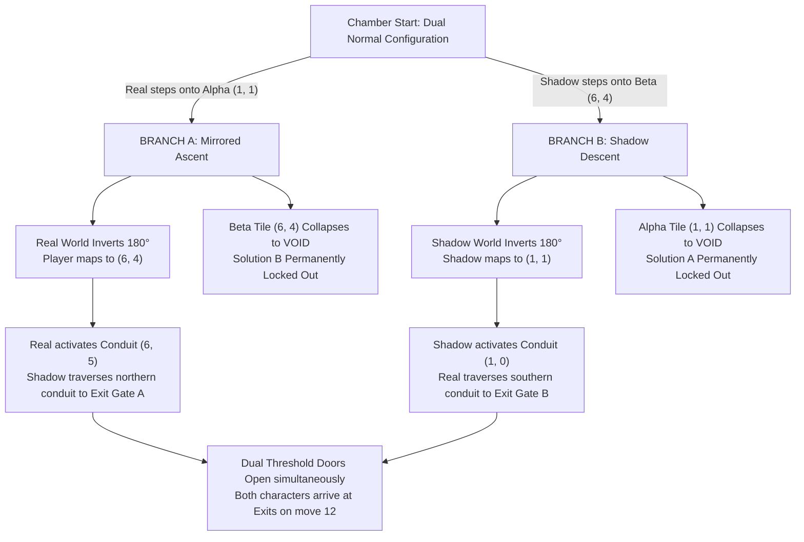

# LEVEL 20 — THE FINAL PARADOX: ULTIMATE DESIGN SPECIFICATION

**Project:** THE OTHER SIDE  
**Chapter:** THE TRUTH (Master Campaign Finale)  
**Tagline:** TWO WORLDS. ONE MIND.  
**Difficulty:** Master (Ultimate Campaign Challenge)  
**Status:** IMPLEMENTED, SOLVED & VERIFIED  

---

## 1. Executive Summary & Design Vision

Level 20, **The Final Paradox**, serves as the intellectual culmination of the entire twenty-chamber campaign. Rather than relying on increased maze dimensions or arbitrary timing windows, Level 20 introduces an original spatial paradigm: **World Inversion**. 

The chamber is governed by a strict **Two-Solution Architecture**:
1. **SOLUTION A — THE MIRRORED ASCENT** (Real World inverts via Alpha; upper terrace bridge aligns; Shadow traverses northern conduit to unlock exit gates).
2. **SOLUTION B — THE SHADOW DESCENT** (Shadow World inverts via Beta; subterranean depths align; Real traverses southern conduit to unlock exit gates).

Exhaustive automated state-space search has mathematically proven that **exactly two solution families exist** (20 paths each, optimal length 12 steps), with strictly **zero unintended shortcuts or hybrid solutions**.

---

## 2. Spatial Architecture & Layout ($8 \times 6$ Grid)

Both worlds operate on identical $8 \times 6$ coordinate grids ($x \in [0, 7]$, $y \in [0, 5]$). The coordinate frames are symmetrical opposites across the 180-degree rotation axis $(x, y) \leftrightarrow (7 - x, 5 - y)$.

### Coordinate Map

```
Row 0: [W] [.] [.] [W] [W] [.] [.] [W]   (Real World)
Row 1: [.] [α] [.] [W] [W] [.] [.] [.]
Row 2: [.] [.] [.] [W] [.] [.] [.] [.]
Row 3: [.] [P] [.] [D] [.] [.] [G] [X]   P: Real Start (1,3) | G: Door (6,3) | X: Exit (7,3)
Row 4: [.] [.] [.] [W] [W] [.] [.] [.]
Row 5: [W] [.] [.] [W] [W] [.] [.] [W]

Row 0: [W] [.] [.] [W] [W] [.] [.] [W]   (Shadow World)
Row 1: [.] [.] [.] [W] [W] [.] [.] [.]
Row 2: [X] [G] [.] [.] [D] [.] [S] [.]   S: Shadow Start (6,2) | G: Door (1,2) | X: Exit (0,2)
Row 3: [.] [.] [.] [.] [W] [.] [.] [.]
Row 4: [.] [.] [.] [W] [W] [.] [β] [.]
Row 5: [W] [.] [.] [W] [W] [.] [.] [W]
```

### Starting & Exit Positions
- **Real Start:** `(1, 3)`
- **Shadow Start:** `(6, 2)` (mirrored inverse: $7-1=6$, $5-3=2$)
- **Real Exit:** `(7, 3)` (guarded by threshold door `door-20-exit-real` at `(6, 3)`)
- **Shadow Exit:** `(0, 2)` (guarded by threshold door `door-20-exit-shadow` at `(1, 2)`)
- **Fixed Dimensional Anchors:** `(6, 3)` in Real World and `(1, 2)` in Shadow World are registered as fixed anchors, preventing dimensional rotation from displacing exit doorways.

---

## 3. Mechanisms & Object Placement

### Doors
| ID | World | Position | Initial State | Activation Rule | Purpose |
|:---|:---|:---|:---|:---|:---|
| `door-20-real-descent` | Real | `(3, 3)` | CLOSED | Switch | Unlocked by Shadow in Solution B |
| `door-20-shadow-ascent` | Shadow | `(4, 2)` | CLOSED | Switch | Unlocked by Real in Solution A |
| `door-20-exit-real` | Real | `(6, 3)` | CLOSED | ANY | Unlocked by Exit Gate A or B |
| `door-20-exit-shadow` | Shadow | `(1, 2)` | CLOSED | ANY | Unlocked by Exit Gate A or B |
| `door-20-ind-a` | Real | `(0, 1)` | CLOSED | Switch | State indicator for Alpha trigger |
| `door-20-ind-b` | Shadow | `(7, 4)` | CLOSED | Switch | State indicator for Beta trigger |

### Switches
| ID | World | Position | Target Object | Behavior | Purpose |
|:---|:---|:---|:---|:---|:---|
| `sw-20-alpha` | Real | `(1, 1)` | `door-20-ind-a` | ACTIVATE_ONLY | Triggers Real Inversion + Beta Void Collapse |
| `sw-20-ascent-conduit` | Real | `(1, 0)` | `door-20-shadow-ascent` | ACTIVATE_ONLY | Inverts to `(6, 5)`; opened for Shadow |
| `sw-20-exit-gate-a` | Shadow | `(2, 2)` | `door-20-exit-real` | ACTIVATE_ONLY | Solution A: unseals Real Exit door |
| `sw-20-exit-gate-a2` | Shadow | `(2, 2)` | `door-20-exit-shadow` | ACTIVATE_ONLY | Solution A: unseals Shadow Exit door |
| `sw-20-beta` | Shadow | `(6, 4)` | `door-20-ind-b` | ACTIVATE_ONLY | Triggers Shadow Inversion + Alpha Void Collapse |
| `sw-20-descent-conduit` | Shadow | `(6, 5)` | `door-20-real-descent` | ACTIVATE_ONLY | Inverts to `(1, 0)`; opened for Real |
| `sw-20-exit-gate-b` | Real | `(5, 3)` | `door-20-exit-real` | ACTIVATE_ONLY | Solution B: unseals Real Exit door |
| `sw-20-exit-gate-b2` | Real | `(5, 3)` | `door-20-exit-shadow` | ACTIVATE_ONLY | Solution B: unseals Shadow Exit door |

---

## 4. Surprise Events & Mutual Exclusion



---

## 5. Visual Evidence & Assets

- Initial Dual World: [phase8-level20-normal.png](screenshots/phase8-level20-normal.png)
- Inverted Real World (Ascent): [phase8-level20-inverted-real.png](screenshots/phase8-level20-inverted-real.png)
- Inverted Shadow World (Descent): [phase8-level20-inverted-shadow.png](screenshots/phase8-level20-inverted-shadow.png)
- Solution A Victory: [phase8-level20-solution-a.png](screenshots/phase8-level20-solution-a.png)
- Solution B Victory: [phase8-level20-solution-b.png](screenshots/phase8-level20-solution-b.png)
- Final Cinematic Ending: [phase8-level20-ending.png](screenshots/phase8-level20-ending.png)
