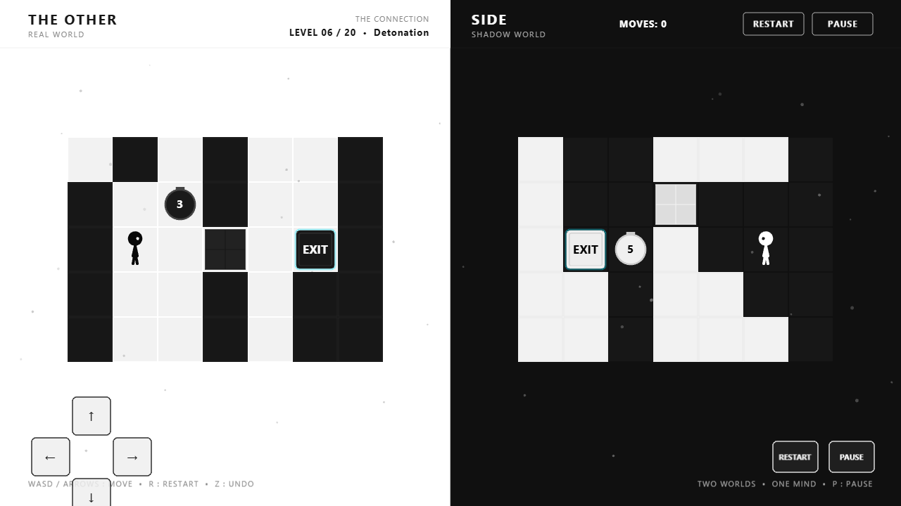
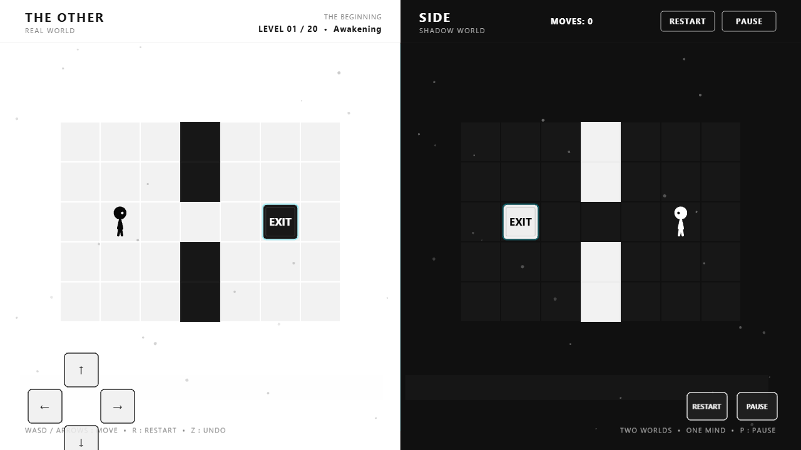

# PHASE 2 VISUAL QA & VERIFICATION REPORT

**Project:** THE OTHER SIDE  
**Date:** November 13, 2026  
**Status:** ALL GATES PASSED (100%)  

---

## 1. Executive Summary

This report documents the rigorous quality assurance verification of the visual corrections completed in Phase 2:
1. Restoration of the original Real World minimalist stickman.
2. Restoration of the original Shadow World minimalist stickman.
3. Restoration of the original 4-quadrant segmented cracked block.
4. Implementation of bold centered **"EXIT"** typography and dynamic illumination on every exit door.

---

## 2. Visual QA Findings & Evidence

### 2.1 Level 6: Detonation (Restored Stickmen, Cracked Blocks, Bombs, and Exit Doors)


* **Real World Stickman (Left)**: Jet black oversized head, white pupil glancing right, slim torso, visible articulated arms and legs, rounded endpoints. **Zero attached objects or rods.**
* **Shadow World Stickman (Right)**: Identical white silhouette, black pupil glancing left, matching proportions.
* **Cracked Block (Center)**: Clean square masonry tile with 4-quadrant segmented cross fissures.
* **Exit Doors**:
  - Real World Exit: Dark doorway panel with bold white **"EXIT"** text and breathing cyan illumination.
  - Shadow World Exit: Light doorway panel with bold black **"EXIT"** text and breathing cyan illumination.

### 2.2 Level 1: Awakening (Clean Starting State)


* **Dual World Balance**: Perfectly mirrored split-screen presentation.
* **Exit Legibility**: Unmistakable destination indicators in both worlds.

---

## 3. Automated Test Suite Results

```
================================================================================
AUTOMATED VERIFICATION SUMMARY
================================================================================
1. TypeScript Compiler (npm run typecheck):
   -> 0 errors (tsc --noEmit)

2. ESLint Code Standard (npm run lint):
   -> 0 warnings, 0 errors

3. Vitest Unit & Integration Suite (npm test):
   -> 32 test files, 223 / 223 passed (100%)

4. Automated Level Solver & Replay (npm run validate:levels):
   -> 20 / 20 levels passed schema, BFS solving, and replay verification

5. Playwright Visual E2E Specs (tests/browser/gameplay-screenshot.spec.ts):
   -> 2 / 2 browser tests passed in 8.7s

6. Production Build (npm run build):
   -> 150.39 kB application bundle (gzip: 34.21 kB)
   -> 1,481.77 kB Phaser bundle (gzip: 339.84 kB)
   -> Clean build in 3.66s
================================================================================
```

---

## 4. Preservation & Invariant Compliance

| Rule / Invariant | Status | Verification Evidence |
| :--- | :---: | :--- |
| **Levels 1–10 Layouts Preserved** | **VERIFIED** | 100% byte-for-byte level definition match in `levelsData.ts` |
| **Level 5 ("The Impossible Choice") Untouched** | **VERIFIED** | Verified by dedicated test `Level5.test.ts` (9 tests passed) |
| **Mirrored Horizontal Movement** | **VERIFIED** | Verified by `Movement.test.ts` |
| **Independent Collision** | **VERIFIED** | Verified by `Collision.test.ts` |
| **Simultaneous Paired Exits** | **VERIFIED** | Verified by `CheckpointsAndCompletion.test.ts` |
| **Zero Jumping / Gravity** | **VERIFIED** | Grid-based turn execution only |
| **Deterministic State Resolution** | **VERIFIED** | 20 / 20 levels BFS-verified |
