# PHASE 3 — VISUAL EFFECTS IMPLEMENTATION REPORT

**Project:** THE OTHER SIDE  
**Date:** November 13, 2026  
**Status:** COMPLETE, AUDITED & VERIFIED  

---

## 1. Executive Summary

Phase 3 delivers the comprehensive animation and visual effects engine for **THE OTHER SIDE**. Building upon the restored character stickman and cracked block baseline, this milestone implements continuous 60 FPS object animations, environmental atmosphere, procedural character feedback, and unmistakable visual identity across all 16 gameplay mechanics and 20 handcrafted levels.

---

## 2. Verified Visual Baseline & Design Preservation

### 2.1 The Two-World Art Direction
- **Real World:** Crisp architectural white background (`#FFFFFF`), solid black minimalist stickman (`#080808`) with white glance eyes, charcoal masonry walls (`#171717`) with 1px inner bevels, and subtle upward charcoal dust motes.
- **Shadow World:** Obsidian void background (`#101010`), pure white minimalist stickman (`#FFFFFF`) with black glance eyes, polished light architectural stone (`#F2F2F2`), and luminous white floating dust motes.
- **Center Divider:** 2px deep charcoal dividing line (`#333333`) featuring a subtle sinusoidal energy shimmer band (`VisualEffectsManager.ts`).
- **Atmospheric Mist:** Semi-transparent drifting fog bands moving horizontally across both worlds with gentle vertical wave displacement.

### 2.2 Stickman "Zero-Carry" Restoration
- Confirmed: The Real World stickman and Shadow World stickman carry zero objects, rods, handles, or blocks.
- The previous visual defect caused by line 85 of `PuzzleObjectRenderer.ts` rendering an exit doorway over the player has been permanently redirected to `session.definition.realExit` and `session.definition.shadowExit`.

### 2.3 Cracked Block 4-Quadrant Restoration
- Restored from Git commit `873f731`. The cracked block features the approved symmetric 4-quadrant segmented cross pattern with progressive crumble stages rather than irregular angular lines.

### 2.4 Exit Door Bold Labeling & Illumination
- Both Real World and Shadow World exit doorways feature crisp, centered **"EXIT"** typography rendered at `depth 18`, ensuring immediate identification beneath characters (`depth 25`) and above floor geometry (`depth 2`).
- The portal threshold exhibits continuous breathing cyan illumination ($0.40 \le \alpha \le 0.85$).

---

## 3. Comprehensive Visual Effects Suite

```mermaid
graph TD
    A[GameScene 60 FPS Update Loop] --> B[CharacterAnimator]
    A --> C[PuzzleObjectRenderer]
    A --> D[VisualEffectsManager]
    
    B --> B1[Idle Breathing & Head Bob]
    B --> B2[Oscillating Walk Stride]
    B --> B3[Squash Anticipation & Landing Bounce]
    B --> B4[Wall Bump Recoil Shudder]
    B --> B5[Portal Singularity Warp & Bloom]
    B --> B6[12-Shard Death Disintegration]
    B --> B7[Checkpoint Ascension Shimmer]
    B --> B8[Exit Arrival Victory Hop]
    
    C --> C1[Rotating Saw Blades 480°/s]
    C --> C2[3-Layer Laser Beams with Jitter]
    C --> C3[Counter-Rotating Portal Vortices]
    C --> C4[Sputtering Bomb Fuses & Countdown]
    C --> C5[3D Pressure Plates 4px Sink]
    C --> C6[45° Toggle Switches with LED]
    C --> C7[Interlocking Chevron Blast Doors]
    C --> C8[Specular Glass Prism Mirrors]
    C --> C9[Concentric Magnetic Force Arcs]
    C --> C10[Chronometer Time Lock Domes]
    
    D --> D1[48 Ambient Dust Motes]
    D --> D2[Drifting Atmospheric Mist Bands]
    D --> D3[Center Divider Energy Shimmer]
    D --> D4[Saw Friction Sparks]
    D --> D5[Detonation Shockwaves & Debris]
    D --> D6[Directional Screen Shake]
```

---

## 4. Layering & Phaser Depth Hierarchy

To guarantee zero clipping and unambiguous visual stacking, all render passes strictly observe the established depth order:

| Depth | Layer Name | Contents |
| :---: | :--- | :--- |
| `0` | Background | Real World white rect, Shadow World obsidian rect, center divider |
| `2` | Static Geometry | Floor tiles, masonry walls, cracked block bases, hazard markers |
| `4` | Ambient FX | 48 floating dust motes, drifting mist bands, divider energy shimmer |
| `15` | Dynamic Puzzle Objects | Saws, lasers, mirrors, portals, switches, doors, plates, time locks |
| `18` | Exit Labels | Bold uppercase **"EXIT"** typography centered over doorways |
| `20` | Dynamic Overlays | High-contrast bomb countdown numbers |
| `25` | Characters | Procedural stickman rigs, squash/stretch transforms, walk strides |
| `26` | Spark Particles | Saw sparks, sputtering fuse sparks, laser impact showers |
| `27` | Shockwaves | Expanding explosion shockwave rings |
| `28` | Shards | 12 radial character disintegration shards |
| `50+`| UI / HUD / Modals | Header status bar, touch controls, pause menu, victory screens |

---

## 5. Quality Assurance & Regression Verification

| Verification Target | Requirement | Measured Result | Status |
| :--- | :--- | :--- | :---: |
| **TypeScript Typecheck** | 0 errors | 0 errors | **PASS** |
| **ESLint Quality Check** | 0 warnings | 0 warnings | **PASS** |
| **Vitest Unit & Integration Suite** | 32 test files | 223 / 223 passed (100%) | **PASS** |
| **Automated Level Solver** | All 20 Levels | 20 / 20 BFS solved & replay verified | **PASS** |
| **Level 5 Integrity Lock** | Strictly preserved | 100% byte-for-byte identical | **PASS** |
| **Levels 1–10 Frozen Scope** | Zero layout drift | 100% identical grid & solutions | **PASS** |
| **Production Build** | `npm run build` | 151.5 kB app / 1.48 MB Phaser (3.78s) | **PASS** |
| **Playwright Screenshot QA** | Visual inspection | Confirmed clean stickman, cracked block, exits | **PASS** |
